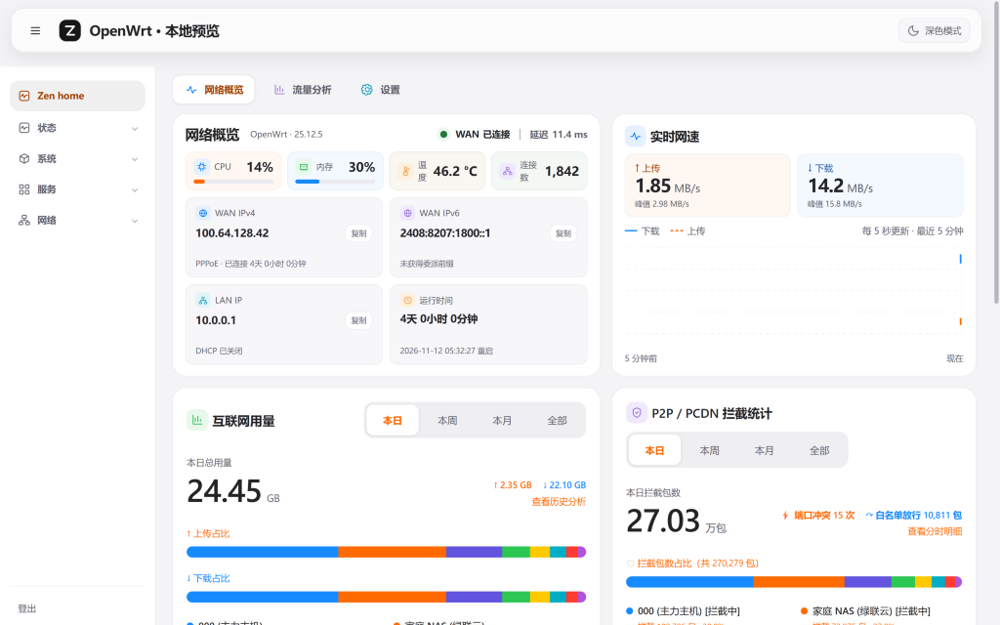
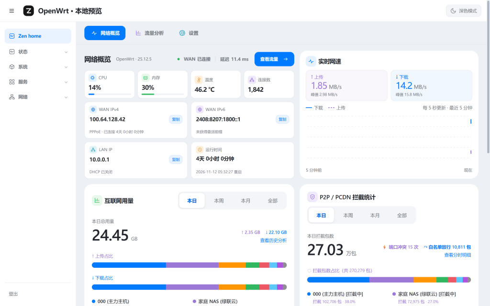
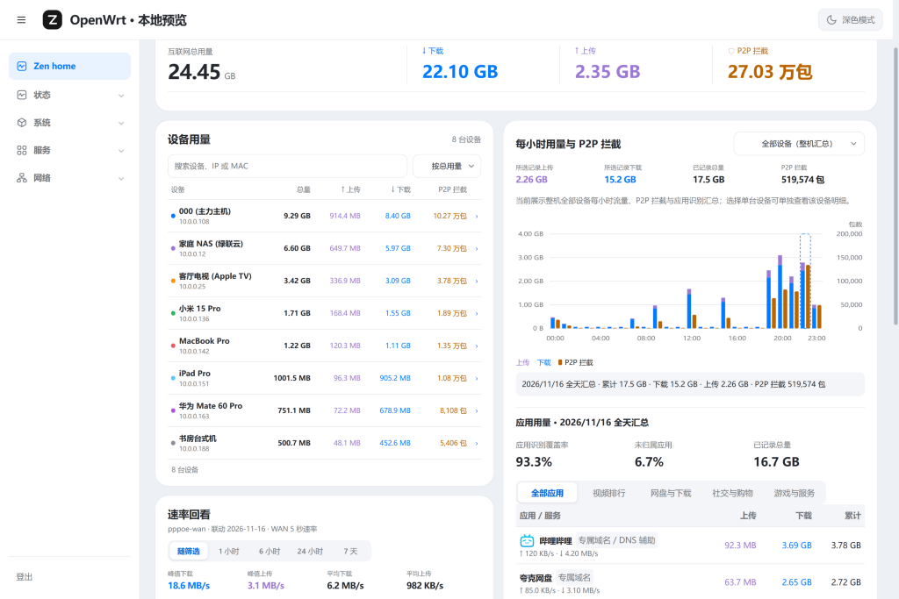
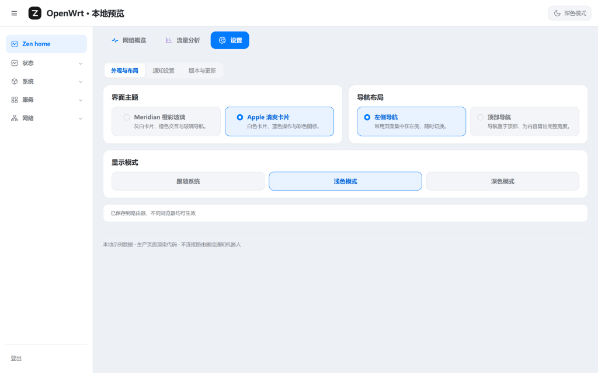

# LuCI Zen

面向 **OpenWrt 25.x / ImmortalWrt 25.x**（`apk` 包管理器、ucode LuCI、无 Lua 依赖）的现代路由器控制台主题与 **Rust + eBPF** 流量监测套件。

| 软件包 | 架构 | 用途 |
| --- | --- | --- |
| `luci-app-zen` | `all` | 全部前端界面：Zen 主题、登录页、网络概览、流量分析、通知与系统设置 |
| `luci-zen` | 匹配目标架构 | Rust / Aya eBPF 采集守护进程、nDPI 6.0 应用识别、SQLite 持久化存储及 `ubus` 服务 |

---

## 核心功能

- **网络概览首页**：CPU、内存、温度与连接数状态条，WAN IPv4 / IPv6 与运行时间卡片（支持一键复制 IP），5 秒粒度实时网速波形，以及「本日 / 本周 / 本月 / 全部」互联网用量与 P2P / PCDN 拦截统计对照。
- **连接设备与详情控制**：搜索、按实时速率排序、品牌与设备类型识别、在线时长与 Wi-Fi/有线协商速率；侧滑抽屉查看单设备互联网/局域网实时速率、限速、绑定名称及近 24 小时用量。
- **深度流量分析（联动速率回看）**：支持按设备、日期范围筛选总用量/日趋势；右侧分时柱状图同轴展示每小时上传/下载与 P2P 拦截包数，支持全路由与多日范围的 **应用用量分布**（覆盖率、专属域名/DNS 辅助来源、视频与网盘分类过滤）；左下角 **速率回看** 支持「随筛选 / 1小时 / 6小时 / 24小时 / 7天」，可与分时柱状图悬停/点击联动，并支持在单设备均速与 WAN 5 秒采样速率间切换。
- **严格 P2P / PCDN 控制**：按设备启用 UDP 端点锁定（`仅观察` / `严格拦截`），支持远端 IP/CIDR 放行规则（IPv4/IPv6）与全局域名白名单定期解析写入内核 LPM 表，实时统计冲突次数、拦截包数与放行包数。
- **飞书 / 企业微信通知**：支持 Webhook 与签名密钥配置、按整机或单设备设置周期用量阈值提醒（超限告警同步附带“设备互联网用量前五”排名）及每日流量汇总定时推送。
- **双主题与自适应布局**：提供 **Meridian 橙彩玻璃** 与 **Apple 清爽卡片** 两套主题，支持浅色 / 深色 / 跟随系统模式，支持左侧栏与顶部导航自由切换，配置保存于路由器并在多浏览器间同步；设置页内置版本检测与路由器端一键在线更新。

---

## 页面预览

| 网络概览（Meridian 橙彩玻璃） | 网络概览（Apple 清爽卡片） |
| --- | --- |
|  |  |

| 流量分析与速率回看联动 | 设置（外观、通知与版本更新） |
| --- | --- |
|  |  |

---

## 运行环境与兼容性说明

1. **适用系统**：基于 **OpenWrt 25.x**（如 `25.12.x`）与 **ImmortalWrt 25.x** 的 `apk` + ucode LuCI 固件。
2. **已构建目标架构**：发布工作流默认产出以下目标的 `.apk` 安装包（前端包 `luci-app-zen` 为 `all` 全架构通用）：
   - `x86/64`（软路由 / 虚拟机等）
   - `rockchip/armv8`（NanoPi R4S / R5S / R5C / R6S 等）
   - `mediatek/filogic`（MT7981 / MT7986 / MT7988 等 Wi-Fi 6/7 硬路由）
3. **内核模块依赖（重要）**：
   - `luci-zen` 依赖 **`kmod-sched-bpf`** 与 **`kmod-sched-core`**（提供 TC `clsact` / `cls_bpf` 钩子）以及内核 `BPF` / `/sys/fs/bpf` 文件系统支持。
   - **必须联网安装**：内核模块严格绑定固件编译时的内核版本（vermagic），无法直接打进本仓库的 `.apk` 中；只要路由器能正常访问其固件配套的在线软件源，执行 `apk update` 后安装 `.apk` 时 `apk` 会**自动安装**这两个依赖。
   - 若使用的是**第三方自编译精简固件**且无配套 `kmods` 源，或固件未开启 eBPF 支持，则无法安装或启动服务（需在编译固件时一并选入 `kmod-sched-bpf` 和 `kmod-sched-core`）。
4. **硬件流量卸载与存储空间**：
   - 开启**硬件流量卸载**（Hardware Flow Offload / PPE / WED / NSS）会使流量绕过内核 TC 挂载点，导致设备统计偏低及 P2P 严格模式不生效；使用完整统计与 P2P 控制时请在防火墙设置中关闭硬件卸载（普通软件卸载可兼容）。
   - `luci-zen` 含 Rust 守护进程、nDPI 引擎与 SQLite 数据库，建议设备具备充裕的 overlay 空间，或将数据库路径修改至外部挂载存储。

---

## 安装方法

### 方式一：下载 Release `.apk` 安装（推荐，OpenWrt 25 / ImmortalWrt 25 通用）

1. 前往 [Releases](https://github.com/zdabing/luci-zen/releases) 下载对应版本与目标后缀的一组包（共两个文件）：
   - `luci-zen-<版本>-<目标>.apk`（例如 `x86-64`、`rockchip-armv8`、`mediatek-filogic`）
   - `luci-app-zen-<版本>-<目标>.apk`（前端为 `all` 架构，任选同版本一个即可）
2. 将两个 `.apk` 上传到路由器 `/tmp` 目录，SSH 登录后联网安装（**务必先 `apk update`** 让系统能自动补齐 `kmod-sched-bpf` 与 `kmod-sched-core`）：

```sh
apk update
apk add --allow-untrusted /tmp/luci-zen-*.apk /tmp/luci-app-zen-*.apk
```

> 如为跨版本升级，请将两个新包放在同一次命令中升级（不要提前卸载旧包或删除数据库）：
> ```sh
> apk update
> apk add --upgrade --allow-untrusted /tmp/luci-zen-*.apk /tmp/luci-app-zen-*.apk
> ```

3. 在 LuCI「**系统 → 系统 → 语言和界面**」中选择 **Zen** 主题，或直接执行命令启用：

```sh
uci set luci.main.mediaurlbase='/luci-static/zen'
uci commit luci
/etc/init.d/rpcd restart
/etc/init.d/zen-traffic enable
/etc/init.d/zen-traffic start
```

### 方式二：通过已签名 APK 软件源安装

若 Release 中随附发布了针对特定 OpenWrt `版本 + target` 的签名软件源（`zen-repository.pem` 与 `install-zen.sh`），核对公钥 SHA256 指纹后可执行一键安装：

```sh
sh install-zen.sh <zen-repository.pem 路径> <公钥 SHA256 指纹> full
```

> 若使用 ImmortalWrt 25 或自编译版本号，脚本找不到完全匹配的签名源标签时，请直接使用上面的 **方式一** 安装对应架构 `.apk`。

---

## 常用配置与排查

### 1. 修改采集 LAN 接口或数据库存储路径

默认监听 `br-lan`，数据库默认保存在 `/etc/zen-traffic/traffic.db`（小 Flash 设备建议改至已挂载的外置存储）：

```sh
# 修改监听 LAN 接口
uci -q delete zen-traffic.traffic.interface
uci add_list zen-traffic.traffic.interface='br-lan'

# 可选：修改数据库路径（目标目录须提前存在且可写）
uci set zen-traffic.traffic.db_path='/mnt/sda1/zen-traffic/traffic.db'

uci commit zen-traffic
/etc/init.d/zen-traffic restart
```

### 2. 一键环境自检与状态诊断

```sh
# 检查内核模块、bpffs 挂载与守护进程状态
/usr/libexec/zen-traffic-check

# 查看服务运行、硬件分载及采集接口状态
ubus call zen.traffic getStatus
ubus call zen.traffic getDevices
logread -e zen-traffic
```

---

## 从源码编译 APK / 集成到固件

### 使用 OpenWrt 25 SDK 单独编译 `.apk`

以下构建命令需在 Linux 或 WSL2 的 Linux 文件系统内执行：

```sh
# 1. 下载并解压对应固件版本的 OpenWrt SDK 及同目录的 llvm-bpf-*.tar.zst（解压 llvm-bpf 到 SDK 根目录）
# 2. 进入 SDK 根目录，拉取源码并放入 package/
git clone https://github.com/zdabing/luci-zen.git ../luci-zen
cp -R ../luci-zen/luci-app-zen ../luci-zen/luci-zen package/

./scripts/feeds update -a
./scripts/feeds install rust libubus libubox clang bpf-headers luci-base

cat >> .config <<'EOF'
CONFIG_PACKAGE_luci-app-zen=m
CONFIG_PACKAGE_luci-zen=m
EOF
make defconfig

make package/luci-zen/compile V=s -j"$(nproc)"
make package/luci-app-zen/compile V=s -j"$(nproc)"

find bin/packages -type f -name '*zen*.apk'
```

### 集成到完整固件源码

将 `luci-app-zen` 与 `luci-zen` 复制到固件源码 `package/` 目录，更新安装 feeds 后在 `make menuconfig` 中选中：
- `LuCI → Applications → luci-app-zen`（自动勾选后台 `Network → luci-zen`）

### GitHub Actions 自动编译发布

仓库内置 [.github/workflows/build.yml](.github/workflows/build.yml)，推送 `v*` 版本标签或手动触发 `SDK Build` 工作流即可基于 OpenWrt 官方 SDK 云端交叉编译并产出全部目标的 `.apk` 安装包与更新清单。

---

## 架构与开源许可

- **设计说明**：
  - 所有经过 LAN 采集点的流量统计与基于 nDPI 6.0 / 社区规则的应用识别均在路由器本地完成，不解密 HTTPS、不上传用户流量明细或域名记录。
  - 默认社区应用规则源于固定上游提交（见 [luci-zen/rules/SOURCES.json](luci-zen/rules/SOURCES.json)），仅采用经过人工审核的专属域名规则，并在独立降权工作进程中执行识别解析。
- **许可声明**：
  - `luci-app-zen` 使用 [Apache-2.0](luci-app-zen/LICENSE) 许可，第三方图标授权见 [THIRD_PARTY_NOTICES.md](luci-app-zen/THIRD_PARTY_NOTICES.md)。
  - `luci-zen` 采用 [GPL-2.0 / LGPL-3.0-or-later / MIT](luci-zen/LICENSE) 组合许可，内置 nDPI 6.0 识别引擎按上游开源非商用配置启用（商业分发说明见 [luci-zen/appid/NOTICE](luci-zen/appid/NOTICE)）。
  - 版本历史变更见 [CHANGELOG.md](CHANGELOG.md)。
